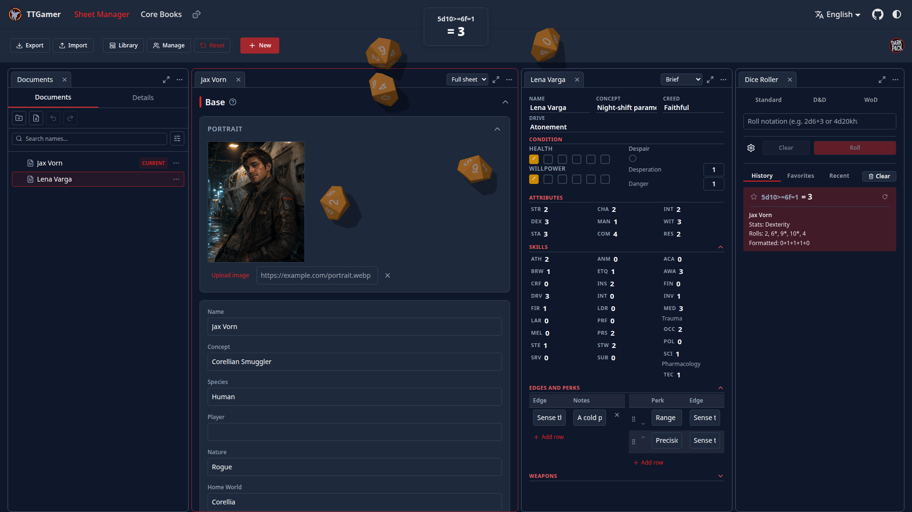
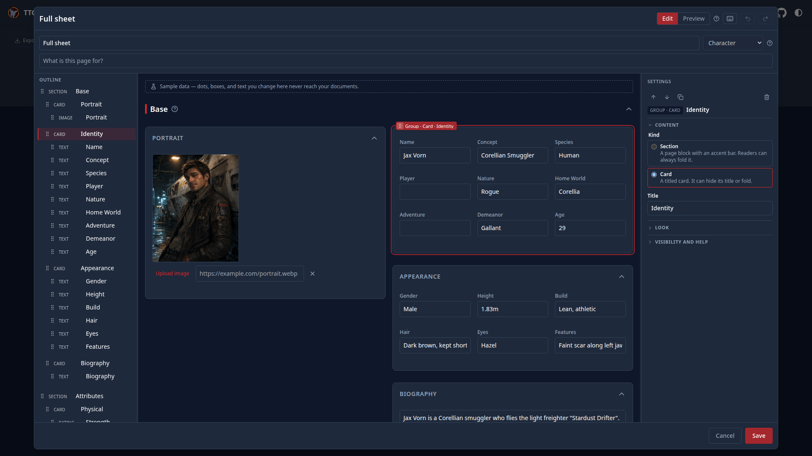
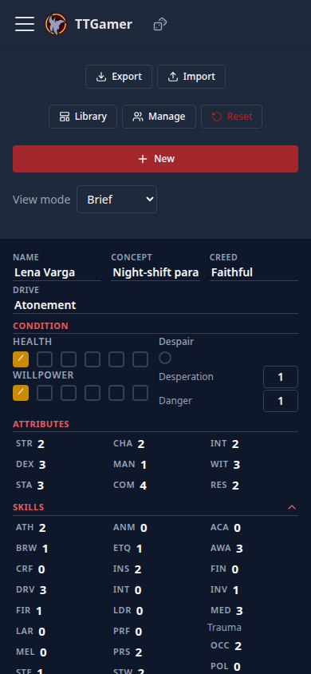
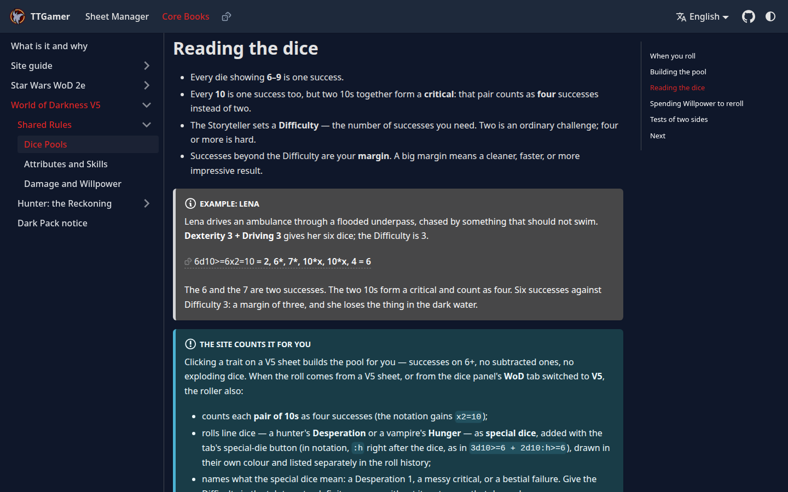
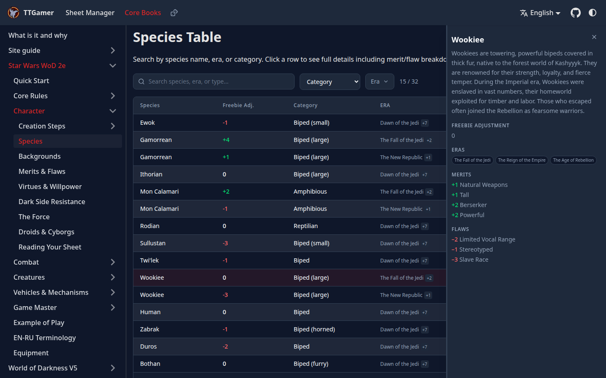
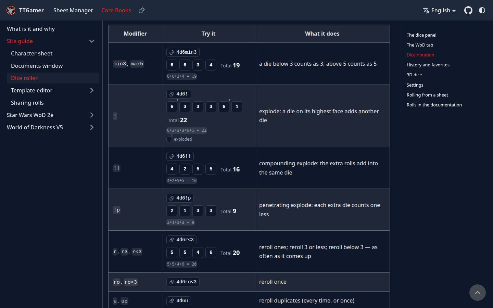

# TTGamer

Character sheets, a dice roller, and rules documentation for tabletop roleplaying games, in one
site that works in the browser and keeps your data on your device.

> **Live site:** [ttgamer.vercel.app](https://ttgamer.vercel.app) · English and Russian



## What it does

### Sheets for several games

| Game                                   | Documents                                         |
| -------------------------------------- | ------------------------------------------------- |
| Star Wars on World of Darkness 2nd Ed. | character, droid, creature, vehicle, fodder group |
| World of Darkness 2nd Edition          | character                                         |
| Hunter: the Reckoning 5th Edition      | character                                         |
| Vampire: the Masquerade 5th Edition    | character                                         |
| World of Darkness 5th Edition          | mortal                                            |

- **Documents, not just characters.** Keep them in folders, search and filter them, undo a move or
  a delete. Every shipped document type has a full sheet and a short **brief** that fits a phone
  screen.
- **Several documents at once.** Arrange documents and tools like the tabs and groups of a code
  editor: split in any direction, drag tabs between groups, float the documents window, the
  library, or the dice roller above the page. The layout is remembered; a phone shows one document
  at a time.
- **Pages you can change.** Every sheet is a template. The **template editor** edits a page in
  place, and the **library** holds the rules, settings, document types, pages, and catalogs your
  documents are built from — including your own settings and types, such as a faction or a ship.
- **Your data stays with you.** Documents are saved in the browser (IndexedDB) as you type, with no
  account. Export a document or a template to a file and import it on another device.

### Dice roller

- Dice notation with explosions, rerolls, keep and drop, success counting, botches, V5 criticals,
  and special dice (Hunger, Desperation); every roll can be shown die by die.
- 3D dice with physics and sound on a table of your choice, or plain 2D results.
- A trait on a sheet rolls its own pool; rolls name the character they came from.
- History and favorites; rolls can be posted to a **Discord** channel or a **Matrix** room.

### Documentation

- Rules for **Star Wars WoD 2e** (a fan conversion of the Star Wars galaxy to the Vampire 2nd
  Edition engine) and **World of Darkness V5** with **Hunter: the Reckoning** and **Vampire: the
  Masquerade**, written in the project's own words.
- Searchable catalogs (species, Force powers, merits and flaws, equipment, vehicles, creatures,
  and more), rolls you can click in the text, and live sheet examples.
- A **site guide** that explains the sheet, the documents window, the dice roller, the template
  editor, and roll sharing with the real interface embedded in the page.

## Screenshots

| Template editor                                         | A brief on a phone                                          |
| ------------------------------------------------------- | ----------------------------------------------------------- |
|  |  |

| Rules with rolls read for you                 | Catalogs                                        |
| --------------------------------------------- | ----------------------------------------------- |
|  |  |



## Game material

TTGamer is a free fan project, not affiliated with the publishers of the games it supports. Rules
are described in the project's own words; names of traits, mechanics, and items are used for
reference.

Each game comes with its own terms, and they do not carry over from one game to another:

- **World of Darkness 5th Edition** (including Hunter: the Reckoning and Vampire: the Masquerade)
  appears under Paradox Interactive's Dark Pack policy: see the
  [Dark Pack notice](https://ttgamer.vercel.app/docs/wod-v5/dark-pack). Its sheets show the Dark
  Pack badge, and exported files carry the notice.
- **The Star Wars conversion and classic World of Darkness 2nd Edition** are outside the Dark Pack.
  No community policy covers them, so they rely only on the own-words rule above and carry no
  badge.
- **A game added later** brings its publisher's own policy (for example, an SRD licence or a
  homebrew content policy). That policy decides what the site may include, which notices it must
  show, and where; it can also rule out parts of a game.

## Development

You need Node.js 22 (see `.nvmrc`) and Yarn 1.

```bash
yarn install
yarn start      # http://localhost:3000
```

| Command                   | What it does                                                     |
| ------------------------- | ---------------------------------------------------------------- |
| `yarn build`              | Production build in `build/` (runs the data and i18n validators) |
| `yarn test`               | Unit and component tests (Vitest)                                |
| `yarn test:e2e`           | Browser tests on the production build (Playwright)               |
| `yarn verify`             | Lint, type check, validators, dead code, and unit tests          |
| `yarn readme:screenshots` | Builds the site and retakes the images in `attachments/`         |

Every command, the project structure, and the rules for changes are in [AGENTS.md](AGENTS.md);
module details are in the `AGENTS.md` file of each module.

The site also ships as a Docker image (nginx) with a Caddy proxy in front, for the stack the online
backend will run in: see [deploy/AGENTS.md](deploy/AGENTS.md).

Built with Docusaurus, React, TypeScript, Zustand, Tailwind CSS, Zod, Three.js with cannon-es, and
a hand-written dice parser.

## Where it is going

The direction of the project is in [ROADMAP.md](ROADMAP.md), the task queue in [TODO.md](TODO.md),
and what changed in each version in [CHANGELOG.md](CHANGELOG.md). Suggestions are welcome on the
[issues](https://github.com/Alamion/TTGamer/issues) page.

## License

[MIT](LICENSE)
